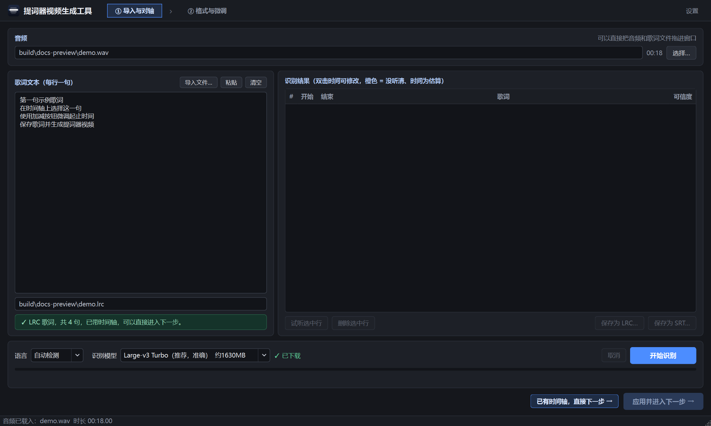
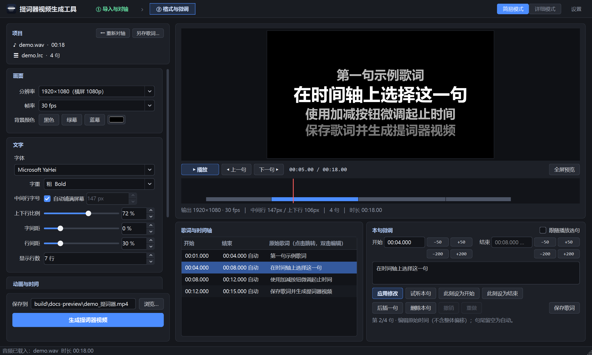

# Teleprompter Maker 提词器视频生成工具

把歌曲音频和歌词制作成清晰易读的提词器视频，用于舞台演出、排练、录音和提词屏播放。

支持黑底、绿幕和蓝幕，大字多行滚动显示，当前句突出显示；可以自动对齐纯文本歌词，也可以导入已有 LRC/SRT 后逐句修正时间。

**当前版本：v1.3.0 · Windows 10/11 64 位 · 简体中文 / English / 日本語**

[完整中文使用手册](docs/USER_GUIDE.md) · [English quick start](build_tools/README_en.txt) · [日本語クイックスタート](build_tools/README_ja.txt) · [发布准备说明](docs/PUBLISHING.md)

## 下载和启动

**本次 GitHub 发布为源码版，许可证为 GPL-3.0-only。** [查看 v1.3.0 发布说明](https://github.com/ben19910518/TeleprompterMaker/releases/tag/v1.3.0)，按下文“从源码运行”安装依赖并启动。当前公开附件不包含 EXE、模型或 CUDA。

本地已有的 Windows 绿色包暂未公开上传：音视频库的完整发行资料仍需核对，见 [第三方声明](THIRD_PARTY_NOTICES.md)。以下绿色包说明适用于已经取得完整运行包的用户：完整解压后双击 `TeleprompterMaker.exe`。

- 绿色版已包含 Python、Qt 和基本音视频运行组件，不用另装 Python，也没有启动脚本。
- 请保留整个文件夹，特别是 `_internal/`；不要只移动 EXE。
- GitHub 的 **Code → Download ZIP** 和本次 Release 的 Source code 下载的都是源码。
- 标准绿色版不含识别模型和 CUDA 库。已有时间轴的歌词可以直接使用；纯文本自动对轴首次需要下载模型，之后可以离线使用。
- 没有 NVIDIA 显卡也能使用。自动对轴可使用 CPU，视频导出默认使用 x264。

## 两种上手流程

### 已有 LRC 或 SRT

1. 在 **① 导入与对轴** 中选择音频，点击 **导入文件…** 载入歌词。
2. 确认提示已带时间轴，点击 **已有时间轴，直接下一步 →**。
3. 在 **② 格式与微调** 中调整画面并试听，点击时间轴或歌词列表选择原句。
4. 用开始/结束的 **±50ms、±200ms** 按钮微调，或直接修改时间和文字。
5. 保存歌词，选择视频保存路径，点击 **生成提词器视频**。

### 只有音频和纯文本歌词

1. 在 **① 导入与对轴** 中选择音频。
2. 直接在左侧输入或粘贴歌词，或者点击 **导入文件…** 载入 TXT；每行一句，演唱重复的句子也要重复填写。
3. 选择歌词的识别语言和模型。首次使用时下载模型，再点击 **开始识别**。
4. 检查右侧结果，试听橙色或低可信行，修正时刻，删除不演唱的标题、作者等行。
5. 点击 **应用并进入下一步 →**，再排版、微调、保存和导出。

应用对轴结果时，程序会尝试自动保存一份 LRC；后续的手工修改仍需主动保存。自动识别结果不是准确率保证，应在导出前试听校对。

## 界面预览

截图来自 v1.3.0。示例文字和静音音频仅用于展示操作，不是附带的歌曲素材。

### 第一步 导入与对轴



### 第二步 格式与微调



顶部步骤条可以随时切换；简易模式和详细模式位于第二步右上方。

## 功能一览

| 模块 | 已提供的功能 |
| --- | --- |
| 音频与歌词导入 | 拖入文件；常见音频格式；LRC、SRT、VTT、ASS、SSA、TXT 歌词 |
| 自动对轴 | faster-whisper；中文、粤语、日语、英语、韩语和自动检测；模型下载；GPU 自动尝试和 CPU 回退 |
| 识别结果校对 | 行级可信度与估算标记；试听、修改起止时间、删除选中行；另存 LRC/SRT |
| 时间轴微调 | 时间轴与原始行联动；句首、句尾分别 ±50ms/±200ms；当前播放位置打点 |
| 歌词编辑 | 修改内容；多行原文/译文；后插一句、删除、撤销/重做、保存、另存 |
| 排版 | 字体和字重、自动字号、前后行比例、字间距、行距、长句折行、当前行位置和边距 |
| 画面 | 黑/绿/蓝背景、自定义颜色、文字颜色与描边、前后行亮度、边缘渐隐 |
| 演唱提示 | 平滑滚动、提前切换、前奏/间奏等待与倒计时、短句显示合并及分段高亮 |
| 预览 | 实时画面、播放和跳转、单句试听、全屏预览及第二屏显示 |
| 视频输出 | H.264；x264 及可用的 NVENC/QSV/AMF；画质、帧率、分辨率、音频码率调整 |
| 界面语言 | 跟随系统或手动选择中英日；即时切换并记住选择 |

逐字时间编辑、工程文件、崩溃草稿恢复、批量导出队列和联网协作不是当前版本的功能。独立 Aligner 的增强 LRC 输出也不等于主界面已支持逐字编辑。

## 最常用的编辑操作

| 操作 | 方法 |
| --- | --- |
| 选中要修正的句子 | 点击/拖动时间轴，或点击原始歌词列表；下方编辑区同步切换 |
| 微调开始与结束 | 使用对应的 ±50ms 或 ±200ms；50ms 一排、200ms 在其下方 |
| 直接输入时间 | 开始/结束输入 `01:23.450` 或秒数 `83.450`，点击应用修改 |
| 设置自动句尾 | 把结束字段留空；列表会显示推算时间和“自动” |
| 按播放位置打点 | 点击“此刻设为开始”或“此刻设为结束” |
| 修改歌词 | 编辑文本框，点击应用修改；切句或保存时也会提交有效草稿 |
| 试听 | “试听本句”或第一步的“试听选中行” |
| 保存 | `Ctrl+S` 保存当前 LRC/SRT；“另存歌词…”选择新文件或格式 |

歌词编辑针对原始行，预览短句合并不会把原句数据合并。编辑时间不含“整体偏移”；播放位置打点会扣除该显示偏移。详见[歌词编辑与保存](docs/USER_GUIDE.md#5-逐句编辑和时间微调)。

## 快捷键

| 按键 | 功能与适用位置 |
| --- | --- |
| 空格 | 主窗口播放/暂停；输入框中保留正常文字输入 |
| ← / → | 主窗口快退/快进 2 秒；文本框和列表自身可能优先处理方向键 |
| ↑ / ↓ | 主窗口上一句/下一句；文本框和列表自身可能优先处理方向键 |
| Ctrl+S | 保存当前带时间轴的歌词 |
| Ctrl+Z / Ctrl+Y | 歌词列表聚焦时撤销/重做；文本框中使用自身的文本撤销 |
| Esc | 退出全屏预览 |

## 模型和显卡

`Large-v3 Turbo` 模型约 1.6 GB，`Small` 约 490 MB。模型下载后保存在 `models/`，复制整个模型目录可供另一台机器离线使用。实际运行速度取决于硬件、音频长度和歌曲内容。

**识别加速与视频编码是两件事：**自动对轴使用 CTranslate2/CUDA；视频输出可使用 NVENC。NVENC 能用，并不代表 CUDA 识别环境也已配齐。查看识别进度中的“显卡加速”或“CPU”确认实际识别设备。

模型路径优先级、离线目录结构和 CUDA 常见问题见[完整手册](docs/USER_GUIDE.md#8-模型下载离线使用和显卡配置)。

## 从源码运行

以下命令在项目根目录的 PowerShell 中执行。当前依赖清单针对 Windows 与 Python 3.13；其他平台尚未在本项目中验证。

```powershell
python -m venv .venv
.venv\Scripts\python.exe -m pip install -r requirements.txt
.venv\Scripts\python.exe TeleprompterMaker.py
```

主程序使用 PyAV 随包的音视频库，常规使用不要求另外安装 `ffmpeg.exe`。识别模型需单独下载。

### 运行测试

```powershell
$env:QT_QPA_PLATFORM = "offscreen"
.venv\Scripts\python.exe -m unittest discover -s tests -v
```

本次发布准备检查中，现有 26 项测试通过；这不代替真实音频的校对和目标机器的兼容性验证。

### 构建绿色版

```powershell
.venv\Scripts\python.exe -m pip install -r requirements-dev.txt
.venv\Scripts\python.exe build_tools\build_i18n_catalog.py
.venv\Scripts\python.exe -m PyInstaller --noconfirm build_tools\TeleprompterMaker.spec
.venv\Scripts\python.exe build_tools\package.py
```

输出位于 `dist/TeleprompterMaker/` 和 `release/TeleprompterMaker_v<版本>.zip`。标准打包脚本排除已下载模型与 `cuda/`，也会清理运行产生的设置和日志。发布 SHA-256 校验文件需要另外生成，命令见[发布准备说明](docs/PUBLISHING.md)。

## 独立歌词对轴工具

源码提供 `LyricAligner.py`，可单独打开对轴界面或命令行生成 LRC/JSON：

```powershell
.venv\Scripts\python.exe LyricAligner.py --audio "song.wav" --text "lyrics.txt" --lang ja --out "song.lrc" --json "song.report.json"
```

主程序的绿色包不等于独立 Aligner 的发行包；主程序 EXE 没有整曲命令行批处理接口。参数和区别见[命令行说明](docs/USER_GUIDE.md#11-独立-aligner-命令行)。

## 目录说明

```text
TeleprompterMaker.py        主程序入口
LyricAligner.py             独立对轴入口
src/teleprompter/           主界面、歌词处理、渲染、导出、多语言
src/lyric_aligner/          识别、模型下载、命令行
tests/                     回归测试
build_tools/               打包脚本、翻译表、随包快速说明
tools/                     图标等开发辅助工具
docs/USER_GUIDE.md          完整操作手册
docs/PUBLISHING.md          GitHub 发布准备与检查结果
docs/images/               文档截图
```

本地的 `.venv/`、`.toolchain/`、`models/`、`cuda/`、`build/`、`dist/`、`release/` 不应提交进源码仓库。

## 问题反馈与贡献

报告问题时请提供软件版本、Windows 版本、操作步骤、预期/实际结果；显卡问题再补充显卡型号与驱动版本，并附相关报错或 `error.log`。请先移除个人文件路径或不希望公开的歌词内容。

改动界面译文时，维护 `build_tools/i18n_translations.tsv`，再运行 `build_i18n_catalog.py`；修复代码后运行现有测试。功能建议可通过仓库的 Issues 讨论。

## 开源与第三方组件

本项目原始代码、文档和原创图标采用 **GPL-3.0-only**，见 [LICENSE](LICENSE) 与 [COPYRIGHT](COPYRIGHT)。允许使用、修改和商业使用；分发程序或修改版时，应遵守 GPL，包括提供对应源码、保留许可与版权声明等要求。

第三方材料保留各自许可，见 [THIRD_PARTY_NOTICES.md](THIRD_PARTY_NOTICES.md)。仓库附带的 Qt 对话框翻译包含对应 TS 源文件；模型、字体、Python/Qt/FFmpeg 运行库不包含在本次源码发行中。
